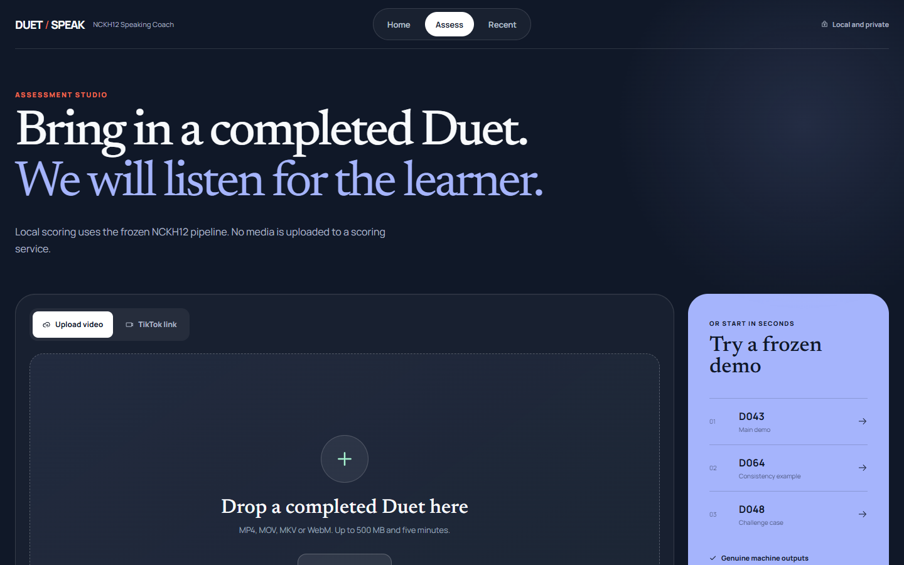
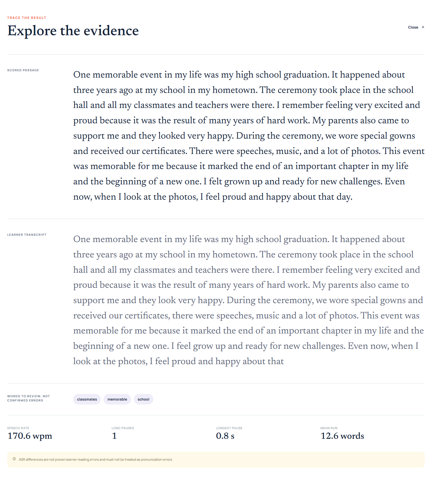

# project_report

- Source: `project_report.pptx`
- Total slides: 28

## Slide 1

DUET / SPEAK

TRƯỜNG THPT CHUYÊN THĂNG LONG · 11/2026

Từ video Duet
đến bằng chứng
luyện nói

Video tham chiếu · Âm thanh gốc · Giáo viên

Giao diện nguyên mẫu thực tế · bản phát hành cục bộ

PHẦN MỀM HỖ TRỢ ĐÁNH GIÁ LUYỆN NÓI TIẾNG ANH ĐA PHƯƠNG THỨC:
KHAI THÁC VIDEO THAM CHIẾU VÀ ĐỐI SÁNH BẰNG CHỨNG GIỌNG NÓI

Báo cáo dự án · Nguyên mẫu nghiên cứu trên bài đọc T001

Nguồn chính: Báo cáo kết quả thực hiện dự án, tháng 11/2026

01 / 28

### Speaker Notes

Kính thưa hội đồng, dự án xuất phát từ nhu cầu hỗ trợ giáo viên xem và phản hồi các bài luyện nói bằng video Duet. Tên đầy đủ của đề tài là Phần mềm hỗ trợ đánh giá luyện nói tiếng Anh đa phương thức: khai thác video tham chiếu và đối sánh bằng chứng giọng nói. Sản phẩm trình diễn có tên DUET / SPEAK. Điểm nhóm muốn làm rõ là dùng video mẫu đã biết để tìm lời học sinh, sau đó lấy bằng chứng từ âm thanh gốc, có thể nghe và kiểm tra lại. Đây là nguyên mẫu nghiên cứu trên bài T001; phần trình bày sẽ tách rõ khả năng vận hành của sản phẩm với độ tin cậy khoa học của việc chấm điểm.

## Slide 2

01 · BÀI TOÁN

Khoảng 150 video mỗi tuần
tạo điểm nghẽn phản hồi

Mở từng video

≈150

Tìm phần học sinh nói

video / tuần

Bối cảnh: khoảng 5 lớp,
hơn 150 học sinh.

Đối chiếu nội dung và nghe lại

Ước tính khối lượng trong báo cáo.

Viết phản hồi để luyện tiếp

Cần hỗ trợ phép đo lặp lại để giáo viên dành thời gian cho phán đoán sư phạm.

Nguồn: Báo cáo Word, Mở đầu §1 · Chưa đo mức tiết kiệm thời gian.

02 / 28

### Speaker Notes

Theo bối cảnh trong phần mở đầu của báo cáo, một giáo viên phụ trách khoảng năm lớp với hơn một trăm năm mươi học sinh có thể nhận khoảng một trăm năm mươi video nếu mỗi em nộp một bài trong tuần. Con số này mô tả khối lượng công việc, không phải cỡ mẫu nghiên cứu và cũng chưa phải kết quả đo thời gian tiết kiệm. Giáo viên phải mở video, tìm lời học sinh, đối chiếu bài đọc và nghe lại trước khi viết phản hồi. Nhóm muốn hỗ trợ những thao tác lặp lại này để giáo viên tập trung hơn vào nhận xét sư phạm. Vì Duet có thể lẫn giọng mẫu, xử lý đúng nguồn lời nói phải đi trước mọi điểm số.

## Slide 3

01 · MỤC TIÊU VÀ CÂU HỎI NGHIÊN CỨU

Ba câu hỏi xác định ranh giới nghiên cứu

RQ1

Học sinh nói ở đâu?

Căn chỉnh và định vị phần lời học sinh trong video Duet.

RQ2

Điểm máy lệch bao nhiêu so với người đánh giá?

Đo sai lệch theo từng tiêu chí, kèm cỡ mẫu và mức tin cậy.

RQ3

Còn cần kiểm chứng gì trước khi sử dụng?

Điều kiện dữ liệu, người chấm và giá trị của phản hồi luyện tập.

Giáo viên đặt chuẩn, xem lại trường hợp bất định và quyết định phản hồi.

Nguồn: Báo cáo Word, Mở đầu §2–3

03 / 28

### Speaker Notes

Ba câu hỏi nghiên cứu đi từ điều kiện kỹ thuật đến điều kiện sử dụng. Thứ nhất, hệ thống có căn chỉnh và tìm đúng vùng lời học sinh không? Thứ hai, sau khi có đầu vào phù hợp, điểm của từng tiêu chí lệch bao nhiêu so với người đánh giá? Thứ ba, những bằng chứng nào còn thiếu trước khi đưa kết quả vào hoạt động dạy học? Việc tách các câu hỏi giúp tránh dùng tỷ lệ xử lý video để trả lời thay cho độ chính xác chấm nói. Trong toàn bộ quy trình, giáo viên vẫn đặt chuẩn, nghe lại trường hợp bất định và quyết định phản hồi. Phần tiếp theo cho biết dữ liệu hiện có đủ trả lời câu hỏi nào.

## Slide 4

01 · DỮ LIỆU VÀ PHẠM VI

68 video cùng T001,
giữ riêng 18 bài kiểm định

Hai lớp 10 Toán và 10 Lý · Mỗi học sinh một video

Bài đọc theo mẫu “One memorable event”; chưa đại diện cho nói tự do.

50 video phát triển

18 video giữ riêng

Không dùng chọn mô hình
hoặc hiệu chỉnh điểm.

12 bài có điểm tham chiếu theo tiêu chí

6 bài có bản chép lời được xác nhận

3 bài P2.5 sau khi khóa cấu hình

Chưa có kết quả kiểm định cuối
trong tài liệu được cung cấp.

Các tập con phục vụ câu hỏi khác nhau; không cộng độc lập.

12 bài: một người nghe có AI hỗ trợ; chưa có độ đồng thuận giữa nhiều giám khảo.

Nguồn: Báo cáo Word §2.1–2.3; P2.4D/P2.5 · Sơ đồ phân nhóm, diện tích không biểu diễn số lượng.

04 / 28

### Speaker Notes

Bộ dữ liệu gốc có sáu mươi tám video của hai lớp mười Toán và mười Lý, mỗi học sinh một video theo cùng bài đọc T001. Năm mươi video được dùng phát triển, còn mười tám video giữ riêng cho kiểm định cuối. Trong tập phát triển, mười hai bài có đánh giá theo tiêu chí, sáu bài có bản chép được con người xác nhận và ba bài khác dùng cho bước P2.5 sau khi khóa cấu hình. Các nhóm này phục vụ những phép thử khác nhau, không nên cộng các số thành những nhóm độc lập. Nhãn của mười hai bài đến từ một người nghe có AI hỗ trợ. Đến tài liệu hiện có, chưa có bảng kiểm định cuối trên mười tám bài giữ riêng; vì vậy chưa thể tuyên bố khái quát ngoài T001.

## Slide 5

02 · CƠ SỞ TIẾP CẬN

Video mẫu đã biết là lợi thế
của bài toán Duet

Video mẫu T001

Đối sánh tham chiếu

Đã biết hình ảnh, giọng và nội dung

Hình ảnh → tương quan thời gian

Video Duet hoàn thành

Âm thanh → dấu hiệu giọng mẫu

Có thể lẫn mẫu, người học và nhiễu

Không cần đoán mọi giọng nói từ đầu.

Đóng góp nằm ở quy trình phù hợp với Duet.

Chưa có thử nghiệm đối chứng để khẳng định vượt mọi phương pháp diarization.

Nguồn: Báo cáo Word §1.2, §2.5.1; duet_segmenter/smart_pipeline.py

05 / 28

### Speaker Notes

Khác với việc chỉ có một bản ghi hỗn hợp, dự án biết trước video mẫu: biết hình ảnh, giọng đọc và nội dung. Điều này cho phép dùng hình ảnh để ước lượng tương quan thời gian, rồi dùng âm thanh để nhận ra phần giọng mẫu còn lẫn. Hướng tiếp cận vì vậy là đối sánh tham chiếu, thay vì yêu cầu mô hình tự phân biệt mọi người nói từ đầu. Đây là cơ sở của quyết định thiết kế và phù hợp với dữ liệu Duet hiện tại. Nhóm chưa có một thử nghiệm ablation hoặc đối chứng đầy đủ để kết luận phương pháp vượt tất cả hệ thống diarization. Đóng góp ở đây là tổ chức một quy trình cụ thể và kiểm soát các nguồn sai số của bài toán.

## Slide 6

02 · LUỒNG XỬ LÝ THỰC TẾ

Pipeline tạo mốc thời gian
trước khi tạo điểm

Chuẩn hóa video / âm thanh

FFmpeg / FFprobe

1

Căn chỉnh với video mẫu

Fingerprint + tín hiệu âm thanh

2

Kiểm tra chất lượng và định vị lời

Quality gate + Silero VAD

3

Lấy đoạn tương ứng từ Duet gốc

RAW_CROPPED / mask

4

Trích bằng chứng và tính tiêu chí

small.en · timing · MultiPA

5

Phản hồi và giáo viên xem lại

Bằng chứng → gợi ý có giới hạn

6

Nguồn: Báo cáo Word §2.4–2.5; smart_pipeline.py; runner.py; competition_demo.py

06 / 28

### Speaker Notes

Luồng xử lý có sáu bước. Video được chuẩn hóa bằng FFmpeg, sau đó căn với video mẫu. Hệ thống kiểm tra chất lượng và dùng Silero VAD để tìm các vùng có thể là tiếng học sinh. Mốc thời gian được chuyển sang bước lấy âm thanh từ Duet gốc; bước này rất quan trọng vì âm đã lọc có thể làm thay đổi đặc trưng cần đánh giá. Tiếp theo, small.en tạo bản chép, các đặc trưng thời gian mô tả độ trôi chảy, còn MultiPA cung cấp các đầu ra phát âm và ngữ điệu có hiệu chỉnh. Cuối cùng, phần mềm tạo phản hồi từ bằng chứng và cho phép giáo viên xem lại. Các cổng kỹ thuật có thể dừng hoặc cảnh báo thay vì buộc mọi đầu vào có điểm.

## Slide 7

02 · CĂN CHỈNH ĐA PHƯƠNG THỨC

Hình ảnh dẫn đường,
âm thanh bổ sung căn chỉnh

01 · Hình ảnh

02 · Âm thanh

Fingerprint xám / gradient
tại nhiều vị trí trên timeline.

Waveform · GCC-PHAT · log-Mel
hỗ trợ khi hình ảnh chưa đủ tin cậy.

≥70% vùng lấy mẫu

Có giọng mẫu → kiểm tra chéo.

Điểm neo hợp lệ phải bao phủ
đủ phần tham chiếu được lấy mẫu.

Mẫu đã tắt tiếng → giữ căn hình.

Hai miền tín hiệu phải đi cùng điều kiện chấp nhận.

Nguồn: Báo cáo Word §2.5.1; duet_segmenter/visual.py, alignment.py, smart_pipeline.py

07 / 28

### Speaker Notes

Căn chỉnh ưu tiên fingerprint hình ảnh mức xám và gradient tại nhiều vị trí trên timeline. Theo báo cáo, điểm neo hợp lệ phải bao phủ tối thiểu bảy mươi phần trăm vùng tham chiếu được lấy mẫu. Đây là điều kiện của phép căn chỉnh, không phải bảy mươi phần trăm toàn bộ lời học sinh đã được xác minh. Khi hình ảnh không đủ tin cậy, waveform, GCC-PHAT và log-Mel hỗ trợ xác định tương quan thời gian. Mã smart_pipeline còn kiểm tra chéo khi giọng mẫu nghe được; khi giọng mẫu đã tắt, hệ thống không ép âm thanh phải khớp một tín hiệu không còn tồn tại. Quyết định này giúp giữ đúng ý nghĩa của từng miền tín hiệu, thay vì cộng cơ học các mô hình.

## Slide 8

02 · KIỂM SOÁT ĐẦU VÀO

GREEN, AMBER, RED là cổng kỹ thuật

GREEN · Có thể tiếp tục theo chính sách xử lý

Bằng chứng đầu vào đủ điều kiện để trích xuất; chưa xác nhận điểm năng lực.

AMBER · Cần nghe và xem xét thêm

Lệch căn chỉnh, giọng mẫu còn lẫn, nhiễu hoặc giọng học sinh quá nhỏ.

RED · Dừng hoặc yêu cầu bản ghi khác

Ví dụ: không có luồng âm thanh hoặc không căn chỉnh đáng tin cậy.

Chất lượng dữ liệu đầu vào ≠ chất lượng bài nói của học sinh.

Nguồn: Báo cáo Word §2.4, §3.1; duet_segmenter/scorability.py, smart_pipeline.py

08 / 28

### Speaker Notes

Ba trạng thái này là phân luồng kỹ thuật của dữ liệu. GREEN cho phép tiếp tục theo chính sách xử lý, nhưng không chứng nhận điểm nói đã có giá trị. AMBER là dấu hiệu cần xem xét thêm, chẳng hạn căn hình và căn âm không thống nhất, giọng mẫu còn lẫn, nhiễu lớn hoặc giọng người học quá nhỏ. RED phản ánh những trường hợp phải dừng hoặc yêu cầu bản ghi khác, như không có âm thanh hay không căn chỉnh đáng tin cậy. Không được diễn giải các màu này thành giỏi, trung bình hay yếu của học sinh. Cách thiết kế có thể tăng số bài cần giáo viên nghe lại, đổi lại hạn chế việc tạo điểm khi đầu vào không đủ căn cứ.

## Slide 9

02 · BẤT BIẾN DỮ LIỆU

Phát hiện trên residual,
đánh giá từ âm thanh gốc

MIỀN PHÁT HIỆN

Linear / AEC3

Residual + VAD

Mốc thời gian

Chỉ giảm giọng mẫu khi cần; residual phục vụ định vị.

Chuyển vị trí,
không chuyển âm

MIỀN ĐÁNH GIÁ

Duet gốc

Crop / mask từ bản gốc

ASR / scorer

Lưu nguồn, hash và phép biến đổi để truy vết.

Âm đã cancellation không được dùng để chấm phát âm hoặc ngữ điệu.

Nguồn: Báo cáo Word §1.2, §2.5.1; speaking_evidence/runner.py:65–149

09 / 28

### Speaker Notes

Đây là bất biến quan trọng nhất của luồng âm thanh. Nếu cần giảm giọng mẫu, Linear Cancellation hoặc AEC3 tạo residual để Silero VAD tìm mốc thời gian. Từ miền phát hiện, hệ thống chỉ chuyển vị trí sang miền đánh giá. Âm thanh đưa vào ASR và scorer được lấy từ Duet gốc bằng các mốc hoặc mặt nạ tương ứng. Trong mã runner, nguồn là duet_path và được kiểm tra bằng require_raw_source trước khi chuẩn bị đầu vào. Các artefact lưu hash nguồn cùng phép biến đổi để truy vết. Nguyên tắc này không bảo đảm crop hoàn toàn sạch; nó bảo đảm âm thanh đã cancellation không bị dùng làm nguồn đo phát âm hoặc ngữ điệu mà không được khai báo.

## Slide 10

02 · BẰNG CHỨNG ĐỘ TRÔI CHẢY

Độ trôi chảy được mô tả
bằng nhịp và khoảng dừng

Tốc độ nói và tốc độ phát âm

NGƯỠNG PHÉP ĐO

0,25 s

Speech rate / articulation rate

Tỷ lệ có tiếng và tỷ lệ dừng

Bắt đầu tính khoảng dừng

Phonation ratio / pause ratio

0,70 s

Độ dài chuỗi từ giữa hai lần dừng

Đánh dấu khoảng dừng dài

Mean length of run; số lần và khoảng dừng dài nhất

Chỉ tính trong lượt nói; không tính khoảng giữa nhiệm vụ.
Timestamp ASR có sai số; tốc độ nói đơn lẻ không đủ kết luận độ trôi chảy.

Nguồn: Báo cáo Word §2.5.2; speaking_evidence/fluency.py:10–85

10 / 28

### Speaker Notes

Độ trôi chảy được mô tả bằng nhiều dấu hiệu thay vì chỉ tốc độ. Speech rate tính trên thời lượng lượt nói; articulation rate dùng thời lượng được phát hiện có tiếng. Phonation ratio, pause ratio, độ dài chuỗi từ và khoảng dừng dài nhất bổ sung thông tin về nhịp. Hàm measure_fluency lấy khoảng giữa các từ từ khoảng không phẩy hai mươi lăm giây để tính dừng và từ không phẩy bảy mươi giây để đánh dấu dừng dài. Chỉ khoảng trong lượt được tính; khoảng trống giữa hai nhiệm vụ không tự động trở thành lỗi ngập ngừng. Các timestamp do ASR tạo vẫn có sai số, nên những phép đo này là bằng chứng cần đặt cạnh việc nghe, chưa phải mô tả đầy đủ năng lực nói.

## Slide 11

02 · PRETRAINED MODEL VÀ HIỆU CHỈNH

MultiPA được tích hợp, hiệu chỉnh
trong miền quan sát

Không huấn luyện lại mô hình nền

Miền điểm có nhãn

Chia âm thanh gốc thành đoạn ≤14,5 s.
MultiPA pretrained tạo điểm thô.
Lấy trung bình không trọng số theo bài.

Phát âm · MultiPA Accuracy
Chỉ quan sát mức 3 và 4

Trôi chảy · mô hình timing: mức 4–5

LOOCV trên 12 bài phát triển

Ngữ điệu · MultiPA: mức 2–5

Mỗi lượt: hiệu chỉnh trên 11 bài,
dự đoán bài còn lại; lặp 12 lượt.

Không ngoại suy sang mức chưa quan sát.

Chọn phương pháp theo từng tiêu chí; mức dễ hiểu vẫn do người nghe đánh giá.

Nguồn: Word §2.5.3, §2.6; MULTIPA_COMPETITION_SCORER_REPORT.md; p24d_multipa.py

11 / 28

### Speaker Notes

Nhóm sử dụng mô hình MultiPA đã huấn luyện sẵn, không huấn luyện lại mô hình nền trên bộ dữ liệu nhỏ. Những đoạn dài được chia tại ranh giới từ, tối đa khoảng mười bốn phẩy năm giây, rồi lấy trung bình điểm thô không trọng số theo bài. Hiệu chỉnh và lựa chọn được thực hiện riêng cho từng tiêu chí. Nhãn phát âm chỉ có mức ba và bốn; độ trôi chảy chỉ có bốn và năm; ngữ điệu có mức hai đến năm. Dự đoán bị giới hạn trong miền đã có nhãn. Trong LOOCV, mỗi lượt dùng mười một bài để hiệu chỉnh và dự đoán bài còn lại, lặp mười hai lần. Độ trôi chảy giữ mô hình timing; mức dễ hiểu chưa có điểm máy ổn định. Đây là đóng góp tích hợp và kiểm soát phạm vi, không phải công bố mô hình nền mới.

## Slide 12

03 · KIẾN TRÚC ĐÃ TRIỂN KHAI

React và FastAPI bao quanh
pipeline Python đã khóa

React 19

FastAPI

Pipeline Python

TypeScript / Vite
Tương tác và hiển thị

Upload / job / result
127.0.0.1 · chạy cục bộ

Tính bằng chứng và tiêu chí
Scorer đã đóng băng

Các thành phần xử lý

FFmpeg · OpenCV · NumPy/SciPy · Silero VAD
faster-whisper · Praat/Parselmouth · MultiPA

Streamlit: công cụ giáo viên / nghiên cứu dùng chung logic đánh giá.

Lưu media, JSON và hash cục bộ; chưa xác minh có CSDL quan hệ trong kiến trúc hiện tại.

Nguồn: Word §2.5.4; product_api.py; media_library.py; pyproject.toml; product_frontend/package.json

12 / 28

### Speaker Notes

Kiến trúc sản phẩm hiện tại dùng React mười chín, TypeScript và Vite cho tương tác; FastAPI làm giao diện upload, job và kết quả. API chạy trên địa chỉ cục bộ, chuyển công việc sang pipeline Python đã khóa. FFmpeg và OpenCV xử lý media, NumPy và SciPy xử lý tín hiệu, Silero tìm hoạt động lời nói, faster-whisper tạo bản chép; Praat và MultiPA tham gia các bằng chứng tiếng nói. Frontend không tự tính lại các điểm nghiên cứu. Streamlit vẫn phục vụ các luồng giáo viên và nghiên cứu với cùng logic nền. Artefact chủ yếu là media, tệp JSON và hash cục bộ; chưa có bằng chứng để vẽ một cơ sở dữ liệu quan hệ vào kiến trúc hiện tại. Phần sản phẩm vì vậy bao quanh, không thay thế, phương pháp đã khóa.

## Slide 13

03 · MINH CHỨNG SẢN PHẨM

Nguyên mẫu có luồng nhập bài,
phân tích và xem lại

01 · Chọn bài

Tải tệp hoặc mở demo
D043 / D064 / D048.

02 · Phân tích

Theo dõi job và trạng thái;
có thể trả kết quả một phần.

03 · Xem lại

Kết quả và thư viện gần đây.

TikTok import thực tế: còn chờ kiểm thử URL.

Nguồn: Word §3.6; FINAL_RELEASE_REPORT.md; ảnh 02_ASSESSMENT.png · Cohort theo lô ở luồng nghiên cứu.

13 / 28

### Speaker Notes

Ảnh này là giao diện thật trong bộ minh chứng final release, không phải giao diện minh họa được dựng cho bài báo cáo. Người dùng tải video hoặc mở một trong ba demo D043, D064 và D048, theo dõi quá trình phân tích, rồi xem kết quả hoặc mở lại bài gần đây. API có trạng thái công việc và sản phẩm có thể báo lỗi hay trả kết quả một phần, thay vì hiển thị đủ điểm giả định. Cần phân biệt luồng cohort theo lô trong công cụ nghiên cứu với luồng sản phẩm hiện thể hiện từng bài. Chức năng nhập TikTok có code, nhưng kiểm thử với URL thật vẫn được báo cáo là đang chờ. Tải tệp cục bộ là luồng minh chứng đáng tin cậy hơn trong tài liệu hiện có.

## Slide 14

03 · BẰNG CHỨNG VÀ PHẢN HỒI

Kết quả nối tiêu chí
với bằng chứng và gợi ý

Bằng chứng có thể xem lại

Bản chép, đối chiếu bài đọc, nhịp nói
và khoảng dừng có mốc thời gian.

Phản hồi cục bộ luôn sẵn có

Gợi ý từ dấu hiệu đã đo được;
AI tùy chọn chỉ diễn đạt lại văn bản.

AI không được đổi điểm hoặc tự thêm lỗi phát âm.
Overall Practice Score là chỉ số mô tả sản phẩm,
chưa được kiểm định như điểm năng lực.

Nguồn: Word §3.6; FINAL_RELEASE_REPORT.md; ảnh D043 04_RESULTS_EVIDENCE.png đã che danh tính.

14 / 28

### Speaker Notes

Ảnh D043 trong bộ minh chứng an toàn cho thấy cách sản phẩm đặt bản chép, đối chiếu bài đọc và các chỉ số nhịp nói cạnh kết quả. Người dùng có thể mở bằng chứng thay vì chỉ nhìn một con số. Lớp phản hồi cục bộ dựa trên các dấu hiệu đã đo và vẫn hoạt động khi không có mạng. Nếu được cho phép, AI chỉ nhận phần văn bản được cho phép và diễn đạt lại lời góp ý; kết quả phải qua kiểm tra hợp đồng dữ liệu. Nó không được đổi điểm hoặc tự thêm lỗi phát âm. Điểm tổng luyện tập là trung bình mô tả của bốn mục hiện có trên giao diện, chưa được kiểm định như một thang năng lực. Vì vậy, khả năng trình bày đẹp và tính hợp lệ khoa học cần được đánh giá riêng.

## Slide 15

04 · KẾT QUẢ CĂN CHỈNH P1.4

62/68 video căn chỉnh được
trong khảo sát P1.4

91,2%

Tỷ lệ xử lý bước căn chỉnh đầu vào

Không phải độ chính xác chấm nói.

58

4

6

58 · Hình ảnh

4 · Bổ sung âm thanh

6 · Chưa đạt

6 bài chưa đủ điều kiện: 5 bài căn chỉnh không tin cậy, 1 tệp không có luồng âm thanh.

Chưa có đánh giá độc lập toàn bộ 68 bài về độ chính xác định vị lời học sinh.

Nguồn: Báo cáo Word §3.1, Bảng 2 · Tổng mẫu N=68; chiều dài các đoạn tỷ lệ theo số bài.

15 / 28

### Speaker Notes

Khảo sát P1.4 trên sáu mươi tám video ghi nhận năm mươi tám bài căn được bằng hình ảnh và bốn bài bổ sung nhờ âm thanh. Tổng cộng là sáu mươi hai trên sáu mươi tám, tương đương chín mươi mốt phẩy hai phần trăm khi làm tròn một chữ số. Sáu trường hợp còn lại gồm năm bài căn chỉnh không tin cậy và một tệp không có luồng âm thanh. Các đoạn của thanh có chiều dài theo đúng số lượng từng nhóm. Kết quả cho thấy khả năng chuẩn bị đầu vào trên dữ liệu thật, nhưng không phải độ chính xác chấm nói, cũng chưa phải đánh giá độc lập độ đúng của mọi đoạn học sinh trên toàn bộ sáu mươi tám bài. Kết quả nhận dạng lời nói được đánh giá bằng một phép thử khác.

## Slide 16

04 · SO SÁNH ASR P2.4 · N=6 BẢN CHÉP THAM CHIẾU

small.en có WER thấp nhất
trên sáu bản tham chiếu

5,02%

small.en

8,69%

distil-large-v3

8,81%

large-v3-turbo

0

2

4

6

8

10%

Cùng âm thanh, CPU int8 và cấu hình giải mã; thấp hơn là tốt hơn.

WER là lỗi chép lời; không được suy thành tỷ lệ học sinh phát âm sai.

Nguồn: Báo cáo Word §3.2; PRETRAINED_MODEL_TOURNAMENT_REPORT.md · Kết quả P2.4, không dùng số P2.2A cũ.

16 / 28

### Speaker Notes

Ở P2.4, ba hệ thống được so trên cùng sáu bản chép tham chiếu con người xác nhận, với cùng âm thanh, CPU int8 và cấu hình giải mã. small.en có micro-WER năm phẩy không hai phần trăm, thấp hơn distil-large-v3 là tám phẩy sáu chín và large-v3-turbo là tám phẩy tám một phần trăm. Nhóm vì vậy giữ small.en theo phép thử này, thay vì giả định mô hình lớn luôn tốt hơn. Đây là số cập nhật P2.4 trong báo cáo Word, khác kết quả P2.2A cũ còn xuất hiện trong README. WER đo lỗi nhận dạng gồm thay, bỏ và thêm từ; không thể lấy một trăm trừ WER để kết luận học sinh phát âm đúng bao nhiêu phần trăm. Sáu bài cũng chưa đại diện nhiều giọng và điều kiện thu.

## Slide 17

04 · KIỂM TRA CHÉO PHÁT TRIỂN · N=12

LOOCV trên 12 bài cho sai lệch
quanh nửa điểm

0,4204

Trôi chảy

0,4912

Phát âm

0,5881

Ngữ điệu

0

0,2

0,4

0,6

0,8

1,0

MAE: sai lệch tuyệt đối trung bình trên thang 1–5; thấp hơn là tốt hơn.

Dữ liệu phát triển · Một người nghe có AI hỗ trợ · Miền nhãn hẹp · Chưa kiểm định độc lập.

Nguồn: Báo cáo Word §3.3; MULTIPA_COMPETITION_SCORER_REPORT.md · 12 lượt: 11 bài hiệu chỉnh, 1 bài dự đoán.

17 / 28

### Speaker Notes

Biểu đồ dùng MAE, tức sai lệch tuyệt đối trung bình giữa điểm dự đoán và mức tham chiếu, trên thang một đến năm. Trong mười hai lượt LOOCV, độ trôi chảy có MAE không phẩy bốn hai không bốn, phát âm không phẩy bốn chín một hai và ngữ điệu không phẩy năm tám tám một. Ngữ điệu lệch nhiều hơn trong phép thử này. Các con số được lấy từ báo cáo thực nghiệm P2.4D và phần kết quả của Word, không suy ra từ giao diện demo. Dù bài dự đoán được để riêng ở từng lượt, đây vẫn là đánh giá trong dữ liệu phát triển đã tham gia lựa chọn phương pháp. Một người nghe có AI hỗ trợ và miền nhãn hẹp khiến kết quả chưa thể xem như kiểm định độc lập hoặc chứng nhận độ chính xác.

## Slide 18

04 · P2.5 SAU KHI KHÓA CẤU HÌNH · N=3 · 07/11/2026

Ba bài P2.5 cho thấy
ngữ điệu còn lệch nhiều

Phát âm

0,4360

Trôi chảy

0,5133

Ngữ điệu

0,7027

0

0,2

0,4

0,6

0,8

1,0

Theo thứ tự phát âm / trôi chảy / ngữ điệu: cùng mức 2/3 · 2/3 · 1/3 bài.

Lệch không quá một mức: 3/3 · 3/3 · 2/3 bài. Không tái hiệu chỉnh theo ba bài này.

Cỡ mẫu quá nhỏ để kết luận khái quát; MAE tính bằng điểm trên thang 1–5.

Nguồn: Word §3.4, Bảng 3; P25_FROZEN_MINI_VALIDATION_REPORT.md · Khác mẫu LOOCV, không suy xu hướng thời gian.

18 / 28

### Speaker Notes

Ngày bảy tháng mười một, cấu hình đã khóa được kiểm tra trên ba bài D064, D043 và D048. Điểm được tạo trước khi đọc các nhãn tương ứng và ba bài không được dùng tái hiệu chỉnh. MAE phát âm là không phẩy bốn ba sáu không, trôi chảy không phẩy năm một ba ba, ngữ điệu không phẩy bảy không hai bảy. Số bài cùng mức lần lượt là hai trên ba, hai trên ba và một trên ba; lệch không quá một mức là ba trên ba, ba trên ba và hai trên ba. Việc giữ mẫu số cho thấy giới hạn rất nhỏ của phép thử. Không nên dùng thay đổi giữa biểu đồ này và LOOCV để nói hệ thống tốt lên hoặc kém đi theo thời gian vì mẫu và thiết kế đánh giá khác nhau.

## Slide 19

04 · XEM TỪNG TRƯỜNG HỢP · D048

D048 bộc lộ giới hạn
của một chỉ số trung bình

Ngữ điệu

Giáo viên: 3

1,2644

Máy: 4,2644

điểm sai lệch tuyệt đối

Thang hiển thị 1–5; lệch hơn một mức.

Phát âm của D048: giáo viên 3, máy 3,8640

Điểm phát âm của cả ba bài chỉ nằm trong khoảng 3,7609–3,8640.

MAE nhỏ với nhãn ít đa dạng chưa chứng minh khả năng phân biệt chất lượng rộng.

Nguồn: Word §3.4; P25_FROZEN_MINI_VALIDATION_REPORT.md · Bảng từng bài ở phụ lục trang 27.

19 / 28

### Speaker Notes

D048 là ví dụ cần được nói thẳng trong phần bảo vệ. Ở ngữ điệu, người đánh giá cho mức ba trong khi máy dự đoán bốn phẩy hai sáu bốn bốn, sai lệch tuyệt đối một phẩy hai sáu bốn bốn điểm. Ở phát âm, người đánh giá cũng cho ba nhưng máy dự đoán ba phẩy tám sáu bốn không. Cả ba điểm máy phát âm chỉ trải từ ba phẩy bảy sáu không chín đến ba phẩy tám sáu bốn không. Điều này nhắc rằng sai lệch trung bình có thể thấp khi nhãn ít đa dạng mà khả năng phân biệt vẫn chưa được chứng minh. Nhóm cần so với cách đoán đơn giản và đánh giá trên dữ liệu đa dạng hơn, không chỉ đưa số trung bình thuận lợi.

## Slide 20

04 · TÌNH TRẠNG TỪNG TIÊU CHÍ

Mỗi tiêu chí có một mức chứng cứ khác nhau

Tiêu chí

Phương pháp

Giới hạn hiện tại

Trôi chảy

Timing đã hiệu chỉnh

Nhãn hẹp; mới kiểm tra bước đầu

Phát âm

MultiPA Accuracy

Sơ bộ; miền nhãn 3–4

Ngữ điệu

MultiPA Prosody

Sơ bộ; sai lệch còn lớn

Đọc đủ nội dung

ASR + đối chiếu 139 từ

Thiếu từ ASR chưa chắc do người đọc

Mức dễ hiểu

Người nghe đánh giá

Chưa có điểm máy ổn định

Điểm tổng luyện tập

Trung bình đều 4 mục

Chỉ số sản phẩm, chưa kiểm định

139 từ: phần bài đọc sau khi tách tiêu đề 3 từ; MultiPA giữ target v1 đã khóa. Điểm tổng không phải CEFR / IELTS.

Nguồn: Word §3.5–3.6; COMPETITION_FINAL_BUILD_REPORT.md; product_api.py:153–190

20 / 28

### Speaker Notes

Sáu dòng trong bảng có mức chứng cứ khác nhau. Trôi chảy dùng timing đã hiệu chỉnh nhưng mới có dữ liệu hẹp; phát âm và ngữ điệu dùng MultiPA ở mức sơ bộ, trong đó ngữ điệu còn sai lệch lớn. Đọc đủ nội dung dùng bản chép tự động đối chiếu phần bài đọc một trăm ba mươi chín từ sau khi tách ba từ tiêu đề. MultiPA vẫn giữ target phiên bản một theo cấu hình đã khóa, nên không được trộn hai ranh giới này khi tái tạo thực nghiệm. Thiếu từ trong ASR chưa chắc là học sinh bỏ từ. Mức dễ hiểu chưa có điểm máy ổn định. Điểm tổng luyện tập chỉ là trung bình đều bốn mục, không có giá trị CEFR hay IELTS. Tính minh bạch về mức chứng cứ quan trọng hơn số lượng chỉ số trên màn hình.

## Slide 21

04 · CẬP NHẬT THEO BÁO CÁO WORD

Kiểm định 68 bài đang thực hiện

Đã chấm thêm 10 bài sau P2.5 theo báo cáo.

Chưa công bố bảng chỉ số; chưa có kết quả đồng thuận đầy đủ trên 68 bài.

Không chuyển nhận xét “tương đồng khá tốt” thành kết quả định lượng.

Khóa cấu hình

Giáo viên chấm mù

So sánh riêng hai tập

Không sửa sau khi xem điểm

Không xem điểm máy trước

Phát triển / 18 bài giữ riêng

Chỉ số dự kiến

Bias · MAE · cùng mức / lệch ≤1 · ICC(2,1) đồng thuận tuyệt đối · QWK
Pearson là chỉ số bổ sung; kết quả trên tập giữ riêng là bằng chứng chính.

Nguồn: Báo cáo Word §3.7 · Trạng thái đang thực hiện, chưa thay các kết quả P2.4D/P2.5 đã công bố.

21 / 28

### Speaker Notes

Mục ba phẩy bảy trong báo cáo Word cập nhật việc đã chấm thêm mười bài sau P2.5 và đang tiến hành đánh giá toàn bộ sáu mươi tám video. Tuy nhiên, tài liệu chưa cung cấp bảng chỉ số mới, nên bài trình bày không biến nhận xét tương đồng khá tốt thành một tỷ lệ hoặc hệ số tự đặt. Kế hoạch là khóa cấu hình, giáo viên chấm trước khi nhìn điểm máy và tổng hợp riêng tập phát triển với mười tám bài giữ riêng. Các chỉ số dự kiến gồm bias, MAE, cùng mức, lệch không quá một mức, ICC đồng thuận tuyệt đối và Kappa có trọng số bậc hai. Pearson có thể bổ sung thông tin nhưng tương quan không tự đồng nghĩa với đồng thuận. Đây là trạng thái công việc còn chờ, chưa thay thế các kết quả đã công bố trước.

## Slide 22

05 · BÀN LUẬN VÀ GIỚI HẠN

Ba giới hạn quyết định
cách sử dụng nguyên mẫu

01

Dữ liệu hẹp → chưa suy rộng

Một bài đọc T001; chưa kiểm chứng nhiều chủ đề, thiết bị và môi trường.

02

Nhãn ít và hẹp → chưa xác nhận thang năng lực

12 + 3 bài, một người nghe có AI hỗ trợ; 18 bài giữ riêng chưa kiểm định cuối.

03

Chưa thử nghiệm sư phạm → chưa kết luận tiến bộ

Kiểm thử phần mềm không thay được đánh giá trước–sau hoặc nhóm so sánh.

Dùng hỗ trợ luyện tập có giáo viên theo dõi; chưa dùng chấm chính thức hoặc quy đổi CEFR / IELTS.

Nguồn: Báo cáo Word §4.2–4.3, Kết luận và kiến nghị · Dữ liệu học sinh cần đồng ý và kiểm soát truy cập.

22 / 28

### Speaker Notes

Ba giới hạn quyết định cách dùng sản phẩm. Thứ nhất là dữ liệu chỉ có một bài T001, chưa đại diện nhiều chủ đề, trình độ hay điều kiện quay. Thứ hai là nhãn ít, hẹp và do một người nghe có AI hỗ trợ; mười tám bài giữ riêng chưa có kiểm định cuối. Thứ ba là nhóm chưa thực hiện thử nghiệm sư phạm để biết học sinh có tiến bộ vì phản hồi hay không. Kiểm thử phần mềm chỉ kiểm tra các hành vi đã thiết kế trong những trường hợp đã thử. Vì thế, cách dùng phù hợp hiện tại là hỗ trợ luyện tập có giáo viên theo dõi, chưa dùng chấm điểm chính thức hoặc quy đổi chứng chỉ. Việc lưu và sử dụng video học sinh cũng cần sự đồng ý và kiểm soát truy cập rõ ràng.

## Slide 23

05 · HƯỚNG PHÁT TRIỂN

Ưu tiên kiểm định
trước khi mở rộng tính năng

Khóa phương pháp và kiểm định 18 bài giữ riêng

Ít nhất hai giáo viên chấm độc lập

Mở rộng bài đọc, mức trình độ, thiết bị và tiếng ồn

Theo dõi luyện lại và thử nghiệm sư phạm trước–sau

MỤC TIÊU THAM KHẢO TRONG BÁO CÁO · CHƯA PHẢI KẾT QUẢ ĐÃ ĐẠT

MAE ≤0,5 điểm · Ít nhất 80% bài lệch không quá một mức

Thu thập có đồng ý; quy định quyền truy cập, thời hạn lưu trữ và rút/xóa dữ liệu.

Nguồn: Báo cáo Word §4.4–4.6, Kiến nghị · Giữ nguyên cấu hình sau khi mở tập kiểm định.

23 / 28

### Speaker Notes

Thứ tự ưu tiên tiếp theo là khóa toàn bộ phương pháp rồi kiểm định mười tám bài giữ riêng, bổ sung ít nhất hai giáo viên chấm độc lập, sau đó mở rộng bài đọc và điều kiện thu. Đánh giá phản hồi cần nhật ký luyện lại, kết quả trước–sau và thiết kế so sánh phù hợp. Báo cáo đặt mốc tham khảo MAE không quá không phẩy năm điểm và ít nhất tám mươi phần trăm bài lệch không quá một mức. Hai con số này là mục tiêu cho lần kiểm định tới, chưa phải kết quả đã đạt và không phải bảo đảm. Nếu không đạt, nhóm cần công bố nguyên nhân thay vì chọn lại mẫu sau khi đã xem tập kiểm định. Thu thập dữ liệu tiếp theo cần quy định sự đồng ý, quyền truy cập, thời hạn lưu và quyền rút hoặc xóa dữ liệu.

## Slide 24

DUET / SPEAK · KẾT LUẬN VÀ THẢO LUẬN

Bằng chứng trước,
kết luận sau.

Đã có nguyên mẫu và quy trình có truy vết.

Dùng video tham chiếu · Giữ âm thanh gốc · Cho phép giáo viên xem lại.

Độ tin cậy chấm điểm cần kiểm định độc lập trước khi dùng chính thức.

Đề nghị: chấm độc lập và hoàn tất kiểm định 18 bài giữ riêng.

Mời phản biện về phương pháp, kết quả và điều kiện sử dụng · Phụ lục: trang 25–28

Kết luận theo Báo cáo Word · Kết quả căn chỉnh 62/68 và WER 5,02% chỉ có ý nghĩa trong các phép thử đã nêu.

24 / 28

### Speaker Notes

Kết luận của nhóm là đã có một nguyên mẫu hoạt động cùng quy trình có thể truy vết: dùng video tham chiếu, định vị lời học sinh, lấy bằng chứng từ âm thanh gốc và cho giáo viên xem lại. Kết quả căn chỉnh sáu mươi hai trên sáu mươi tám và WER năm phẩy không hai phần trăm có ý nghĩa trong đúng các phép thử đã trình bày; chúng không chứng nhận năng lực chấm nói tổng quát. Độ tin cậy điểm cần được kiểm định độc lập trước khi dùng chính thức. Nhóm đề nghị hỗ trợ việc chấm độc lập và hoàn tất kiểm định mười tám bài giữ riêng. Xin mời hội đồng phản biện về phương pháp, kết quả và điều kiện sử dụng; bốn trang phụ lục tiếp theo dùng để đối chiếu kỹ thuật khi cần.

## Slide 25

PHỤ LỤC A · TRIỂN KHAI VÀ KIỂM THỬ

API, lưu trữ và kiểm thử
có thể truy vết

Luồng bất đồng bộ ở sản phẩm

KẾT QUẢ LƯU TRONG RELEASE 13/11

193 Python tests đạt

POST /api/media/upload
POST /api/media/{id}/assess
GET /api/jobs/{id}
GET /api/media/{id}/result

2 bỏ qua có chủ đích
5 frontend tests · 8 Playwright tests

Không chạy lại trong tác vụ tạo slide.

Media / kết quả JSON / hash lưu cục bộ

Media mới được tách khỏi dữ liệu nghiên cứu: research_membership=false.

Kiểm thử chức năng chứng minh hành vi đã thử; chưa chứng minh giá trị đánh giá giáo dục.

Nguồn: product_api.py:create_app; media_library.py; FINAL_RELEASE_REPORT.md, mục Verification

25 / 28

### Speaker Notes

Phụ lục này minh họa các endpoint có thật trong create_app: tải media, tạo job đánh giá, hỏi trạng thái job và lấy kết quả của media. Kết quả được lưu cục bộ với hash để kiểm tra đúng nguồn; media mới không tự trở thành thành viên tập nghiên cứu. Báo cáo final release ngày mười ba tháng mười một ghi một trăm chín mươi ba kiểm thử Python đạt, hai bỏ qua có chủ đích, năm kiểm thử frontend và tám kiểm thử Playwright. Đây là kết quả lưu sẵn trong repository, không phải bộ kiểm thử đã chạy lại trong tác vụ soạn slide. Chúng hỗ trợ đánh giá hành vi phần mềm, chưa thay thế kiểm định độ tin cậy điểm hoặc hiệu quả giáo dục.

## Slide 26

PHỤ LỤC B · TRÍCH LƯỢC MÃ NGUỒN HIỆN TẠI

Hai bất biến được thể hiện
ngay trong mã nguồn

1 · Nguồn đầu vào là Duet gốc

source = Path(row\["duet_path"\])
require_raw_source(source)
audio = prepare_turn_audio(source, turn, audio_path, config\["audio"\]\["sample_rate"\])

2 · Điểm nằm trong miền hiệu chỉnh đã khóa

return round(max(float(low), min(float(high), float(score))), 4)

Các dòng được chọn từ hai hàm khác nhau; đây không phải một chương trình độc lập.

Nguồn: speaking_evidence/runner.py:65–98; speaking_evidence/p24d_multipa.py:304–323

26 / 28

### Speaker Notes

Ba dòng ở phần trên lấy từ run_pair trong runner: nguồn là duet_path, được require_raw_source kiểm tra, rồi prepare_turn_audio chuẩn bị từ chính nguồn đó. Dòng phía dưới lấy từ apply_fitted_mapping trong p24d_multipa, giới hạn kết quả giữa low và high trước khi làm tròn. Các trích đoạn thuộc hai hàm khác nhau, không phải một chương trình có thể chạy độc lập. Chúng cho phép hội đồng kiểm tra rằng hai nguyên tắc dữ liệu và miền điểm có hiện diện ở cấp triển khai, chứ không chỉ trong phần diễn giải báo cáo. Chúng cũng không thay cho đánh giá thực nghiệm rằng các mốc thời gian hoặc điểm dự đoán đã đúng.

## Slide 27

PHỤ LỤC C · KẾT QUẢ TỪNG BÀI · N=3

P2.5: điểm từng bài và sai lệch tuyệt đối

Bài

Tiêu chí

Giáo viên

Máy

|Sai lệch|

D064

Phát âm

4

3,7609

0,2391

D064

Trôi chảy

4

4,7100

0,7100

D064

Ngữ điệu

3

3,7622

0,7622

D043

Phát âm

4

3,7950

0,2050

D043

Trôi chảy

5

4,6100

0,3900

D043

Ngữ điệu

4

3,9184

0,0816

D048

Phát âm

3

3,8640

0,8640

D048

Trôi chảy

4

4,4400

0,4400

D048

Ngữ điệu

3

4,2644

1,2644

Thang 1–5; một người nghe có AI hỗ trợ. Scorer khóa trước khi đọc nhãn P2.5; không dùng để tái hiệu chỉnh.

Nguồn: P25_FROZEN_MINI_VALIDATION_REPORT.md, Per-item results · N=3, không công bố tương quan như bằng chứng khái quát.

27 / 28

### Speaker Notes

Bảng giữ chín cặp điểm theo từng bài và tiêu chí từ báo cáo P2.5. Có thể dùng nó để kiểm tra lại MAE của ba tiêu chí thay vì chỉ tin biểu đồ tổng hợp. Ví dụ, ba sai lệch phát âm là không phẩy hai ba chín một, không phẩy hai không năm không và không phẩy tám sáu bốn không; trung bình làm tròn thành không phẩy bốn ba sáu không. D048 ngữ điệu là trường hợp lệch lớn nhất trong bảng, một phẩy hai sáu bốn bốn điểm. Scorer được khóa trước khi đọc các nhãn này, và không được dùng chúng để tái hiệu chỉnh. Cỡ mẫu ba cùng nhãn một người nghe có AI hỗ trợ không đủ cho một kết luận thống kê ổn định về khả năng khái quát.

## Slide 28

PHỤ LỤC D · NGUỒN VÀ ĐỐI CHIẾU

Nguồn ưu tiên và tài liệu kỹ thuật

01 · Báo cáo và artefact của dự án

Báo cáo kết quả thực hiện dự án, Trường THPT Chuyên Thăng Long, 11/2026.
P2.4: PRETRAINED_MODEL_TOURNAMENT_REPORT.md
P2.4D: MULTIPA_COMPETITION_SCORER_REPORT.md
P2.5: P25_FROZEN_MINI_VALIDATION_REPORT.md; FINAL_RELEASE_REPORT.md (13/11).

02 · Nghiên cứu và phần mềm nền

Chen, Y.-W., Yu, Z., & Hirschberg, J. (2024). MultiPA. Interspeech, 297–301.

isca-archive.org/interspeech_2024/chen24c_interspeech.html · DOI: 10.21437/Interspeech.2024-123

Radford et al. (2023). Robust Speech Recognition via Large-Scale Weak Supervision.

PMLR 202, 28492–28518 · proceedings.mlr.press/v202/radford23a.html

Silero Team. Silero VAD, kho mã chính thức: github.com/snakers4/silero-vad.

Nguồn ngoài mô tả phương pháp; mọi số liệu thực nghiệm trên slide là kết quả riêng của dự án.

28 / 28

### Speaker Notes

Nguồn ưu tiên là báo cáo Word tháng mười một năm hai nghìn không trăm hai mươi sáu, sau đó đối chiếu các báo cáo thực nghiệm P2.4, P2.4D, P2.5 và final release trong repository. Các số liệu dự án không lấy từ benchmark công bố của mô hình ngoài. Tài liệu nền đã kiểm tra gồm bài MultiPA của Chen, Yu và Hirschberg tại Interspeech hai nghìn không trăm hai mươi bốn, bài Whisper của Radford và cộng sự tại PMLR hai nghìn không trăm hai mươi ba, và kho chính thức Silero VAD. Trong báo cáo Word có chỗ ký hiệu số tài liệu chưa thống nhất; bài trình bày đối chiếu theo tên công trình để tránh gán nhầm. Những nội dung chưa có artefact đủ kiểm chứng, như kết quả đồng thuận mới trên sáu mươi tám bài, được giữ ở trạng thái đang thực hiện.
